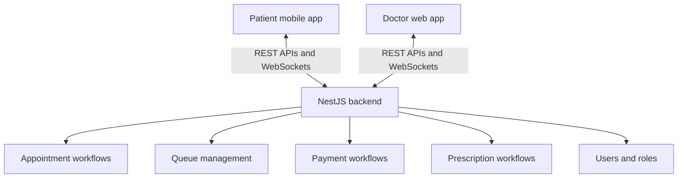

# CareQ — Healthtech Platform Case Study

CareQ is a healthcare product concept and implementation case study focused on appointment booking, live queues, and coordination between patients and clinic teams. Its intended outcome is to make patient flow more visible and help clinics manage scheduled visits and walk-ins.

> **Repository scope:** This repository contains case-study documentation and externally hosted media references. Application source code, deployment configuration, automated tests, and measured outcomes are not included. The capabilities and technology choices below are described in the supplied project write-up; they have not been verified against a running application or codebase.

## The problem

Patients need clear appointment availability and queue updates. Clinic teams need a shared view of scheduled appointments, walk-ins, and consultation progress. CareQ describes a connected patient mobile app, doctor web app, and backend to support these workflows.

## Product workflows

| Audience | Described workflow |
| --- | --- |
| Patients | Register, discover specialists, view slots, book appointments, join and track queues, receive updates, and access consultation information and prescriptions. |
| Doctors and clinic teams | Manage scheduled visits and walk-ins, review queues, update consultation status, coordinate patient flow, and view operational information. |
| Administration | Manage users and roles and support appointment, payment, and prescription operations. Detailed administrator screens are not supplied. |

A typical journey is: discover a doctor → select a slot → book a visit → track the queue → attend the consultation → access the prescription. Payment is described as part of the platform, but its provider and exact place in this journey are unspecified.

## Described capabilities

- Doctor and specialist discovery and appointment-slot booking.
- Live queue tracking for scheduled patients and walk-ins.
- Real-time appointment and queue updates over WebSockets.
- Separate patient and doctor workflows with role-based access.
- Payment and prescription workflows.
- Doctor-side operational dashboard and appointment/queue analytics.

These are product descriptions, not evidence of production availability, security assurance, clinical validation, or regulatory compliance. No numerical improvements in waiting time or clinic performance have been supplied.

## Technology described in the project write-up

| Layer | Stated technology | Verification boundary |
| --- | --- | --- |
| Patient mobile app | React Native | Source and build instructions not supplied. |
| Doctor web app | React.js and shadcn/ui | Source and dependency versions not supplied. |
| Backend | NestJS | Service implementation not supplied. |
| API communication | REST APIs | API specification not supplied. |
| Real-time updates | WebSockets | Event contracts and reconnection behavior not supplied. |
| Authentication | Role-based access | Provider, permissions, and controls unspecified. |
| Payments | Gateway integration | Provider, payment states, and webhook handling unspecified. |
| Development tools | Git, GitHub, Postman | No Postman collection is included. |

The database, hosting platform, notification service, and deployment topology are not identified in the supplied materials.

## Conceptual architecture

This diagram summarizes the documented relationships; it does not establish a deployed service topology.

## Project previews

The following image references were carried over from the supplied README. Their contents, ownership, and continued availability have not been independently verified.

  
  
  
  

The supplied README also linked to two Upwork-hosted video attachments. Their references are retained in the [repository review](docs/repository-review.md) pending confirmation of ownership and public accessibility.

## Contributions and attribution

This case study is maintained in [prince05iitkgp/healthtech-platform-case-study](https://github.com/prince05iitkgp/healthtech-platform-case-study). Repository ownership does not by itself establish authorship of the application or linked media.

The supplied write-up describes work across product planning, React Native development, doctor-facing interfaces, backend/API integration, WebSocket queues, authentication, payments, prescriptions, and testing. Individual contributions and titles have not been independently established, so they are not assigned to a named person here.

See the [name, attribution, and evidence review](docs/repository-review.md) for references that need confirmation before adding a personal portfolio statement.

## Running the project

There is no runnable application in this repository, so installation commands, environment variables, and deployment steps cannot be provided yet. A reproducible developer guide requires the application source, dependency manifests, database configuration, environment-variable template without secrets, migrations, and startup instructions.

## Evidence needed for a technical review

- Source for the mobile app, doctor app, and backend, with dependency versions.
- API specification, data model, and queue event/state definitions.
- Tests covering concurrent booking, queue transitions, access permissions, and payment callbacks.
- A working demo and approved media suitable for public sharing.
- Documented deployment, data-handling controls, and measured pilot results before making production or outcome claims.

## License

No license has been supplied. This repository does not currently grant an explicit open-source license for the documentation, application, or linked media.
